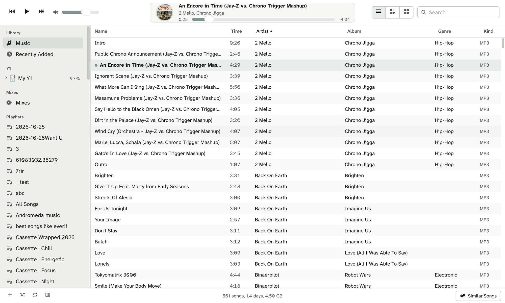
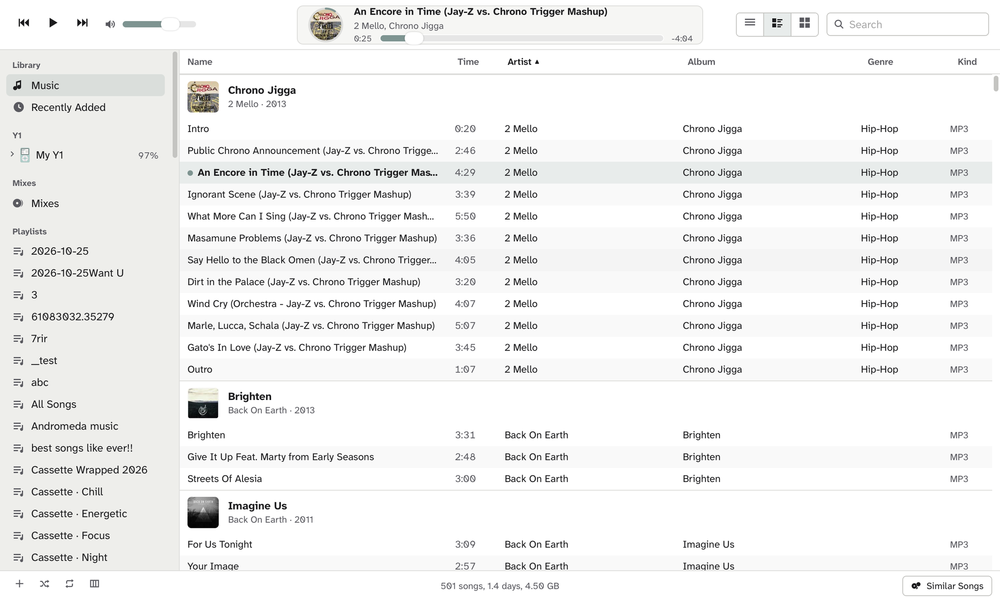
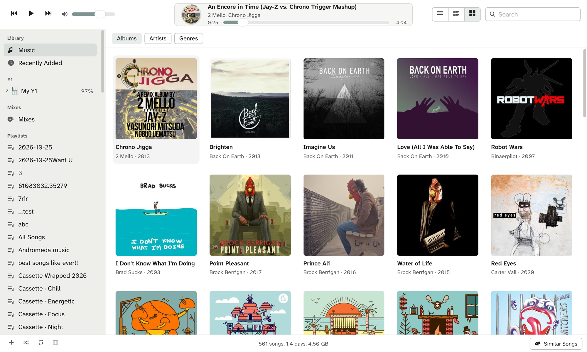
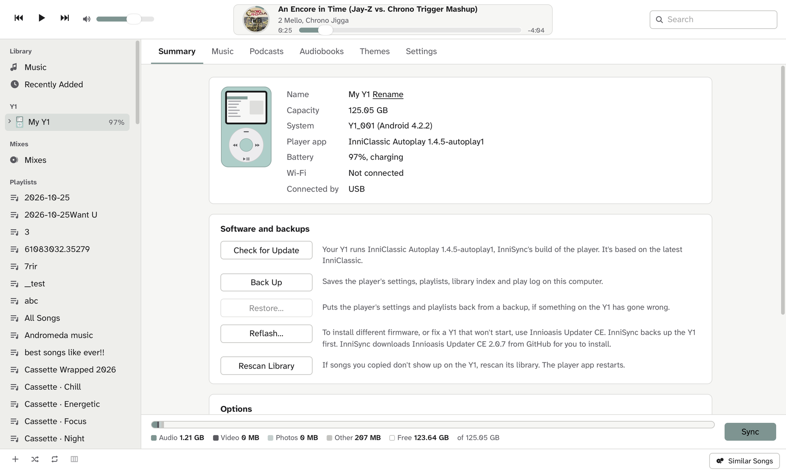
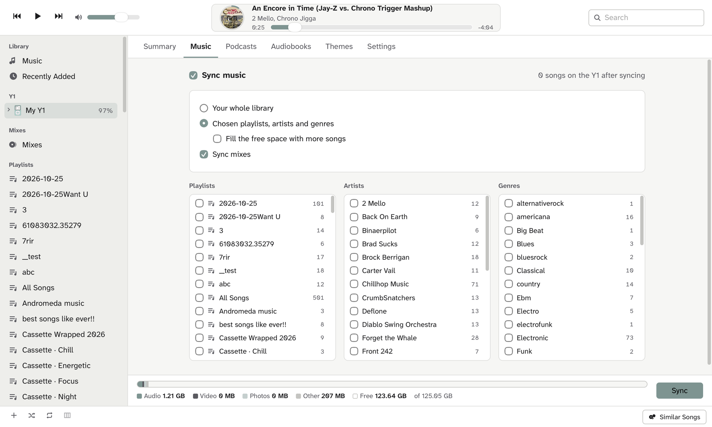
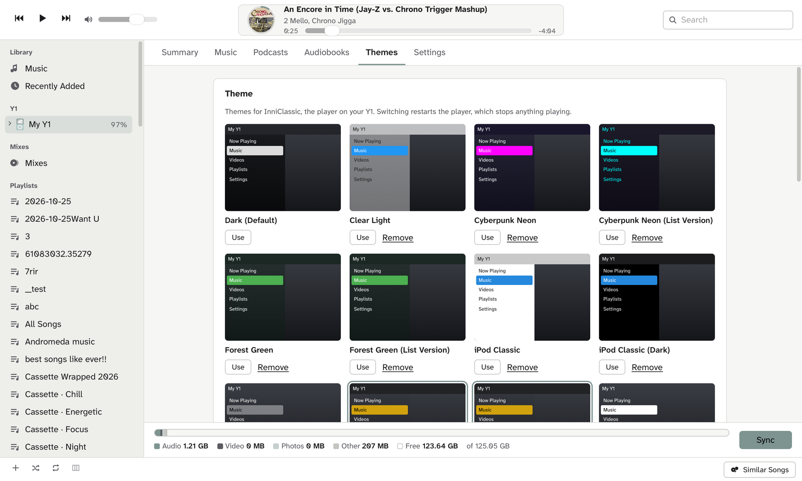
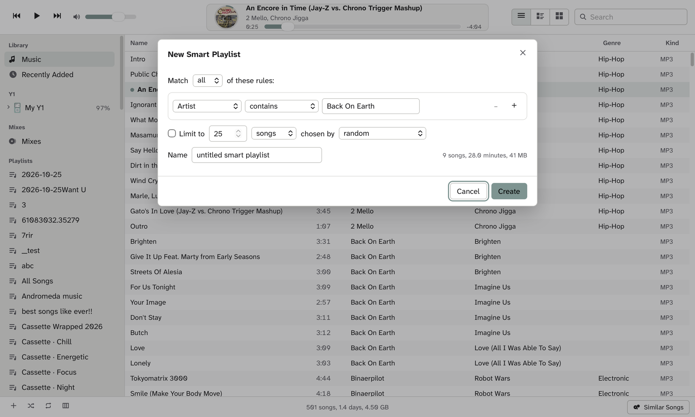
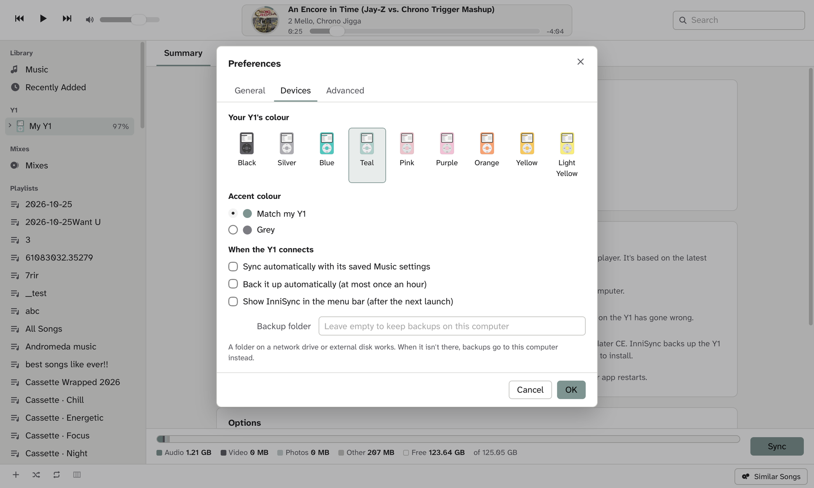
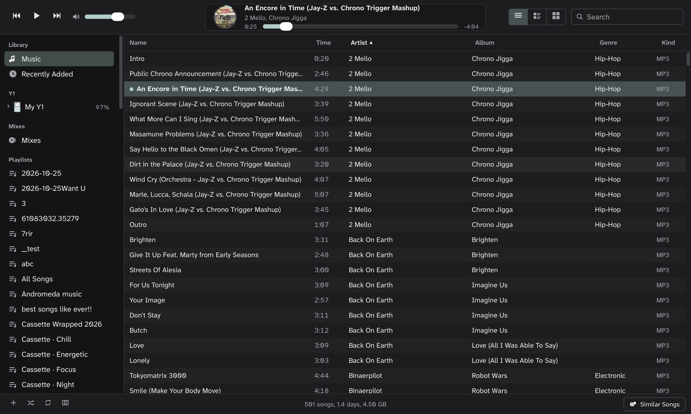

# InniSync

A desktop companion for the **Innioasis Y1** music player. Your music lives on your own server (Jellyfin, or a
Subsonic server such as Navidrome); InniSync puts the songs you choose on the Y1 over USB, and looks after the
player itself: updates, backups, podcasts, audiobooks, themes and settings.



InniSync is an unofficial project. It is not made by or affiliated with Innioasis or Apple.
The screenshots use the public [Navidrome demo](https://demo.navidrome.org) library.

## What it is
The Y1 is a small music player with a click wheel. It runs Android 4.2 underneath, and most owners replace its
player app with [InniClassic](https://github.com/FabianZettl/inniclassic). Getting music onto it normally means
dragging files around by hand.

InniSync is the desktop side. Sign in to your music server once, tick the playlists, artists or genres you want on
the Y1, and click Sync. InniSync copies what's new, removes what you unticked, writes your playlists, and keeps going
from there: it only ever touches the songs it put on the Y1, never files you added yourself.

## What it does
- **Your library on your computer:** browse and play your Jellyfin or Subsonic library as songs, songs by album, or
  covers, with search, a column browser, playlists and smart playlists.
- **Sync to the Y1:** your whole library or chosen playlists, artists and genres, with a preview of how much space it
  will take before anything is copied. Lossless songs can be converted to 320 kbps MP3 so more fits.
- **Mixes and similar songs:** InniSync listens to the songs on your Y1 and groups the ones that sound alike into
  mixes, or lists the songs that go with one you pick. Either can go to the Y1 as a playlist.
- **Autoplay on the Y1:** with [InniClassic Autoplay](https://github.com/johnnmoody/inniclassic-autoplay), which
  InniSync installs for you in one click, the Y1 keeps playing matching songs when its queue runs out.
- **Play counts:** plays logged on the Y1 are counted on your music server when you sync.
- **Lyrics:** timed lyrics from your server, or looked up on [LRCLIB](https://lrclib.net), shown on the Y1's
  Now Playing screen.
- **Podcasts and audiobooks:** episodes go into InniClassic's own Podcasts menu, books into its Audiobooks folder,
  where the Y1 remembers your place.
- **Themes, wallpaper and settings:** switch InniClassic themes, set a wallpaper, and change the player's settings
  from your computer.
- **Updates, backups and restore:** install InniClassic updates from GitHub (each download is checked against its
  published checksum), back up the player's settings and playlists, restore them, and hand off to Innioasis Updater
  CE when the firmware needs reflashing.
- **Wi-Fi:** see the Y1's status and send play counts without the cable. Only your computer can connect, and
  restarting the Y1 turns it off. Music still copies over USB, because the Y1's Wi-Fi is too slow for it.
- **Menu bar:** the Y1's battery and sync progress at a glance, with Sync Now and Back Up Now.

## Screenshots
| | |
|---|---|
|  |  |
| Songs by album | Covers, grouped by album, artist or genre |
|  |  |
| The Y1: software, backups and options | Choosing what syncs, with the space it takes |
|  |  |
| InniClassic themes, previewed in their own colours | A smart playlist made from rules |
|  |  |
| Your Y1's colour sets the accent colour | Light and dark follow your computer |

## Getting started
### What you need
- A Mac (macOS 12 or later, Apple silicon), a Windows 10 or 11 PC, or a Linux PC. The interface is the same on all
  of them.
- A Jellyfin server, or a Subsonic-compatible one such as Navidrome, gonic or Airsonic.
- A Y1 running InniClassic that `adb` can reach over USB: with the Y1 plugged in, `adb devices` lists it.
- `adb` and `ffmpeg`, which InniSync uses but doesn't include:

| System | Install them with |
|---|---|
| macOS | `brew install ffmpeg` and `brew install --cask android-platform-tools` ([Homebrew](https://brew.sh)) |
| Windows | `winget install Gyan.FFmpeg Google.PlatformTools`. If `adb devices` doesn't list the Y1, install its USB driver with [Innioasis Updater CE](https://github.com/y1-community/Innioasis-Updater). |
| Linux | Your package manager, for example `sudo apt install ffmpeg adb` |

### Download
Get the file for your system from the [latest release](https://github.com/johnnmoody/innisync/releases/latest):
- **macOS:** unzip `InniSync-<version>-macos.zip` and move InniSync to Applications. InniSync isn't notarised by
  Apple (that needs a paid developer account), so the first time, open it, then go to System Settings, Privacy &
  Security, and click Open Anyway.
- **Windows:** unzip `InniSync-<version>-windows.zip` anywhere and run `InniSync.exe` in the InniSync folder. If
  SmartScreen warns about an unknown publisher, click More info, then Run anyway.
- **Linux:** unpack `InniSync-<version>-linux.tar.gz` and run `InniSync/InniSync`. It opens in your web browser.
  Sign-ins are kept in your desktop's keyring (GNOME Keyring or KWallet).

Each release lists SHA-256 checksums in `SHA256SUMS.txt`.

### Build it yourself
You need Python 3.12 or later and Node 20.19 or later.
```bash
git clone https://github.com/johnnmoody/innisync.git
```
On a Mac, this builds `/Applications/InniSync.app`, which uses a Python environment in `~/.venvs/innisync`:
```bash
bash innisync/tools/build_app.sh
```
Anywhere, the downloadable app (with Python inside) is built like this, into `dist/`:
```bash
cd innisync/ui && npm ci && npx vite build && cd ..
```
```bash
pip install -r requirements-build.txt && python tools/build_release.py
```

### First run
1. **Sign in.** Click Sign In. For Jellyfin, enter your server's address and click Sign In with Quick
   Connect, then approve the code from any device already signed in to Jellyfin (Settings, then Quick Connect). For
   Navidrome or another Subsonic server, enter the address, your user name and password. Your password stays in the
   system's own password store (the macOS Keychain, Windows Credential Manager, or your Linux keyring); only a salted
   token is sent.
2. **Plug in the Y1.** It appears in the sidebar under Y1, with its battery level.
3. **Pick your Y1's colour** in Preferences, Devices. The Y1 can't report it, and it sets InniSync's accent colour
   (or choose Grey).

## Using InniSync
### Your library
- Double-click a song to play it on your computer. The round cover in the top bar fills its ring as the song plays.
- Switch between **Songs**, **Songs by album** and **Covers** with the buttons at the top right.
- Turn on the **column browser** (Genres, Artists, Albums) from the button at the bottom left, or Cmd+B (Ctrl+B on Windows and Linux).
- **New playlist:** the + button at the bottom left. **Smart playlist:** Option-click +, or File, New Smart
  Playlist. Right-click a smart playlist to edit or delete it.
- **Similar Songs** (bottom right) lists songs on your Y1 that go with the selected one. Keep on Y1 makes it a
  playlist that's rebuilt on every sync.

### Choosing what goes on the Y1
Click the Y1 in the sidebar, then the **Music** tab.
- Choose your whole library, or tick playlists, artists and genres.
- The bar along the bottom shows how the Y1's space would look after syncing. If it won't fit, it says by how much.
- Click **Apply** to save your choices, or **Sync** to save and copy. Progress shows in the top bar, and you can
  cancel there.
- Songs go to `Music/InniSync/<artist>/<album>/` on the Y1, playlists to `Y1_Playlists/InniSync - <name>.m3u8`.
  Anything else on the Y1 is left alone.

### Mixes and Autoplay
InniSync analyses how each song on your Y1 sounds, in the background on your computer. **Mixes** in the sidebar shows
the groups it found; double-click one to play it. Sync mixes (Music tab) puts them on the Y1. For Autoplay, click
**Use Autoplay** on the Summary tab: InniSync installs InniClassic Autoplay beside InniClassic, copies your settings to
it and turns Autoplay on, and the Y1 carries on with matching songs when a queue ends. **Use InniClassic** switches
back; each app keeps its own settings.

### Podcasts
The **Podcasts** tab shows the Y1's own podcast subscriptions (the ones in InniClassic's Podcasts menu). Paste a feed
address to subscribe. Choose to include the most recent episodes of every podcast or only some, or tick episodes one
by one; they copy on the next sync.

### Audiobooks
The **Audiobooks** tab adds books to the Y1's Audiobooks folder, the only place where it remembers where you stopped.
Choose the files of one book, give it a title, and they're copied in order. Audible .aax files are copy protected and
won't play; .m4b books are repackaged as .m4a so the Y1 lists them.

### Themes and settings
The **Themes** tab switches InniClassic themes (each shown in its own colours), adds theme .zip files, sets a
wallpaper picture (fitted to the Y1's 480 × 360 screen), and copies community themes for the Y1's original player.
The **Settings** tab changes InniClassic's own settings: shuffle, repeat, equalizer, backlight, clicker and clock.
Click Apply; the player restarts to pick them up.

### Software and backups
On the **Summary** tab:
- **Check for Update / Update:** installs a newer version of the Y1's player app (InniClassic, or InniClassic
  Autoplay) from GitHub, after backing up the Y1 and checking the download's checksum and signer. Its settings are
  kept.
- **Use Autoplay / Use InniClassic:** switches the Y1 between the two player apps (see Mixes and Autoplay).
- **Back Up:** saves the player's settings, playlists, library index and play log. Choose where in Preferences,
  Devices (a network drive works); InniSync can also back up automatically each time the Y1 connects.
- **Restore:** puts settings and playlists back from a backup. The Y1 is backed up first.
- **Reflash:** for new firmware, or a Y1 that won't start. InniSync backs up the Y1, then opens Innioasis Updater CE
  (downloading it if needed).
- **Rescan Library:** if songs don't show up on the Y1.

### Keyboard shortcuts
On Windows and Linux, use Ctrl where this says Cmd.

| Keys | Does |
|---|---|
| Space | Play or pause |
| Cmd + Right / Left | Next / previous song |
| Cmd + Up / Down | Volume up / down |
| Up / Down, Return | Move through songs, play the selected one |
| Cmd + F | Search |
| Cmd + B | Show or hide the column browser |
| Cmd + , | Preferences |

## Troubleshooting
- **The Y1 doesn't appear.** Check `adb devices` lists it. If not, try another cable or USB port; a charge-only cable
  won't work.
- **Switching music servers.** Sync keeps the Y1 matching the library you're signed in to. If you sign in to a
  different server, the next sync replaces the songs that came from the old one. A sync that would take most of the
  Y1's songs off stops and asks first (**Remove and Sync**), in case the server was offline or still scanning.
- **A sync had problems.** Click **Show Problems** at the top. Songs that didn't copy are tried again next sync, and
  a song is only removed from the Y1 once its replacement is safely there.
- **Songs are missing on the Y1.** Click Rescan Library on the Summary tab.
- **The Y1's clock is wrong** (it resets when the battery runs flat). A Fix Clock button appears on the Summary tab.
- **Over Wi-Fi, nothing copies.** That's expected: the Y1's Wi-Fi is too slow for music. Plug it in to sync.
- **Something else.** The log is at `~/Library/Logs/InniSync.log`.

## Development
Run the server and the interface separately:
```bash
python3 run.py --server-only   # the API on 127.0.0.1:8765
```
```bash
cd ui && npm install && npm run dev   # the interface, with the API proxied
```
`INNISYNC_DATA=/some/folder` runs a separate copy with its own settings. `run.py --selftest` drives the real app
window through every area and writes the results to `~/Library/Logs/InniSync.log`.
Tests: `python -m pytest -q` (see [CONTRIBUTING.md](CONTRIBUTING.md)).

- `innisync/` the server: `server.py` (HTTP, and who may talk to it), `routes/` (the API, one module per area),
  `state.py` (preferences, the library, the connected Y1), library clients (`jellyfin.py`, `subsonic.py`), the Y1
  over adb (`device.py`), sync (`sync.py`), sound analysis (`soundalike.py`), smart playlists, podcasts, play counts,
  lyrics, themes, backups, updates, Wi-Fi, and the menu-bar item.
- `tests/` see [CONTRIBUTING.md](CONTRIBUTING.md).
- `ui/` the interface (Svelte). `DESIGN.md` holds its design direction.
- `tools/` the app build and the icon drawing.

## Credits
- [InniClassic](https://github.com/FabianZettl/inniclassic) by FabianZettl
- [Atkinson Hyperlegible Next](https://github.com/googlefonts/atkinson-hyperlegible-next), SIL Open Font License
- [LRCLIB](https://lrclib.net) for timed lyrics
- [Innioasis Updater CE](https://github.com/y1-community/Innioasis-Updater) by the Y1 community
- Screenshots: the public [Navidrome demo](https://demo.navidrome.org) library

## License
MIT, see `LICENSE`. The bundled Atkinson Hyperlegible Next font is under the SIL Open Font License
(`ui/src/fonts/OFL.txt`). InniClassic Autoplay is a separate project under InniClassic's own license.
